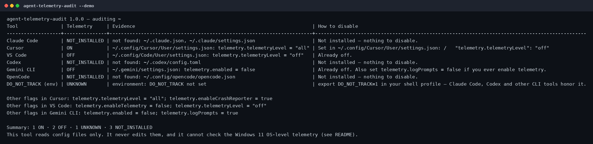

# agent-telemetry-audit

**Find out which of your AI coding tools phone home — and exactly how to turn each one off. One command, zero dependencies, nothing edited.**



## Why now

On 2026-11-16, Xusheng Li [reverse-engineered Windows 11's `MissionControlAggregator.dll`](https://xusheng.dev/posts/windows-coding-agent-telemetry/) and showed it records which coding agents (`claude.exe`, `codex.exe`, `copilot.exe`, `cursor.exe`, …) and developer tools you run, then queues that report for upload as optional diagnostic data — on by default. The story hit the top of Hacker News on 2026-11-17 (432 points, [discussion](https://news.ycombinator.com/item?id=50524736)).

The Windows part needs Windows Settings. But the tools themselves also phone home, each with its own opt-out hidden in a different config file. This tool audits **that** half: it reads the real config files on your own machine and tells you, per tool, whether telemetry is ON, OFF, UNKNOWN, or the tool is NOT_INSTALLED — with the exact file and setting as evidence.

## Quick start (30 seconds)

```bash
git clone https://github.com/Mahgal/agent-telemetry-audit.git
cd agent-telemetry-audit
python3 telemetry_audit.py
```

Python 3.11+ standard library only. No install, no network, no account. The tool only **reads** config files — it never edits anything.

## What it checks

| Tool | Config file read | Switch it looks for | Default if unset |
|---|---|---|---|
| Claude Code | `~/.claude.json`, `~/.claude/settings.json` (+ env) | `env.DISABLE_TELEMETRY`, `env.DO_NOT_TRACK`, `env.CLAUDE_CODE_DISABLE_NONESSENTIAL_TRAFFIC` | ON — usage metrics on by default |
| Cursor | `~/.config/Cursor/User/settings.json` | `telemetry.telemetryLevel` | UNKNOWN (default unverified) |
| VS Code | `~/.config/Code/User/settings.json` | `telemetry.telemetryLevel` | ON — default is `"all"` |
| Codex | `~/.codex/config.toml` | `analytics.enabled`, `[otel] exporter` | UNKNOWN — anonymous metrics on by default, OTel export off by default |
| Gemini CLI | `~/.gemini/settings.json` (+ env) | `telemetry.enabled` | OFF — telemetry is opt-in |
| OpenCode | `~/.config/opencode/opencode.json` (+ env) | `OTEL_EXPORTER_OTLP_ENDPOINT` | OFF — nothing exported by default |
| `DO_NOT_TRACK` | environment | `DO_NOT_TRACK=1` | not set |

It also lists **any other telemetry-ish flags** it finds in those files (crash reporters, prompt logging, `share`, OTel blocks, …), so a second switch can't hide behind the first. Malformed JSON/TOML is reported as UNKNOWN with the parse error, never a crash. VS Code / Cursor `settings.json` files are JSONC in practice (comments, trailing commas) and are parsed leniently.

Defaults above are documented, not guessed: Claude Code ([env-var reference](https://cc.bruniaux.com/guide/settings-reference/), [privacy guide](https://www.getvoibe.com/resources/claude-code-privacy-settings/)), Gemini CLI ([telemetry docs](https://geminicli.com/docs/cli/telemetry/) — `enabled` defaults to `false`), Codex ([OTel docs](https://docs.base14.io/instrument/component/collecting-codex-telemetry/), [config reference](https://last9.io/docs/integrations/codex/)), OpenCode ([no telemetry by default](https://particula.tech/blog/opencode-offline-mode-air-gapped)).

## Example output

### Demo — reproducible anywhere

`python3 telemetry_audit.py --demo` audits the bundled fake home in `examples/demo-home/` (Cursor ON, VS Code OFF, Claude Code absent). Output is byte-identical on every run:

```
agent-telemetry-audit 1.0.0 — auditing ~
Tool               | Telemetry     | Evidence                                                              | How to disable
-------------------+---------------+-----------------------------------------------------------------------+-----------------------------------------------------------------------------------------------
Claude Code        | NOT_INSTALLED | not found: ~/.claude.json, ~/.claude/settings.json                    | Not installed — nothing to disable.
Cursor             | ON            | ~/.config/Cursor/User/settings.json: telemetry.telemetryLevel = "all" | Set in ~/.config/Cursor/User/settings.json: /   "telemetry.telemetryLevel": "off"
VS Code            | OFF           | ~/.config/Code/User/settings.json: telemetry.telemetryLevel = "off"   | Already off.
Codex              | NOT_INSTALLED | not found: ~/.codex/config.toml                                       | Not installed — nothing to disable.
Gemini CLI         | OFF           | ~/.gemini/settings.json: telemetry.enabled = false                    | Already off. Also set telemetry.logPrompts = false if you ever enable telemetry.
OpenCode           | NOT_INSTALLED | not found: ~/.config/opencode/opencode.json                           | Not installed — nothing to disable.
DO_NOT_TRACK (env) | UNKNOWN       | environment: DO_NOT_TRACK not set                                     | export DO_NOT_TRACK=1 in your shell profile — Claude Code, Codex and other CLI tools honor it.

Other flags in Cursor: telemetry.telemetryLevel = "all"; telemetry.enableCrashReporter = true
Other flags in VS Code: telemetry.enableTelemetry = false; telemetry.telemetryLevel = "off"
Other flags in Gemini CLI: telemetry.enabled = false; telemetry.logPrompts = true

Summary: 1 ON · 2 OFF · 1 UNKNOWN · 3 NOT_INSTALLED
This tool reads config files only. It never edits them, and it cannot check the Windows 11 OS-level telemetry (see README).
```

### Real run — this machine (Linux VM, 2026-11-17)

`python3 telemetry_audit.py`, copied verbatim from the actual run (exit 0). No coding agent is installed here, so the honest answer is "nothing to turn off":

```
agent-telemetry-audit 1.0.0 — auditing /home/hatch
Tool               | Telemetry     | Evidence                                           | How to disable
-------------------+---------------+----------------------------------------------------+-----------------------------------------------------------------------------------------------
Claude Code        | NOT_INSTALLED | not found: ~/.claude.json, ~/.claude/settings.json | Not installed — nothing to disable.
Cursor             | NOT_INSTALLED | not found: ~/.config/Cursor/User/settings.json     | Not installed — nothing to disable.
VS Code            | NOT_INSTALLED | not found: ~/.config/Code/User/settings.json       | Not installed — nothing to disable.
Codex              | NOT_INSTALLED | not found: ~/.codex/config.toml                    | Not installed — nothing to disable.
Gemini CLI         | NOT_INSTALLED | not found: ~/.gemini/settings.json                 | Not installed — nothing to disable.
OpenCode           | NOT_INSTALLED | not found: ~/.config/opencode/opencode.json        | Not installed — nothing to disable.
DO_NOT_TRACK (env) | UNKNOWN       | environment: DO_NOT_TRACK not set                  | export DO_NOT_TRACK=1 in your shell profile — Claude Code, Codex and other CLI tools honor it.

Summary: 0 ON · 0 OFF · 1 UNKNOWN · 6 NOT_INSTALLED
This tool reads config files only. It never edits them, and it cannot check the Windows 11 OS-level telemetry (see README).
```

## Turning things off

`--fix` **prints** the exact commands/settings for everything found ON — and for UNKNOWN tools, the setting to apply to be sure. It never applies anything; applying is your choice:

```bash
python3 telemetry_audit.py --fix
```

| Tool | How to disable |
|---|---|
| Claude Code | In `~/.claude/settings.json`: `{ "env": { "DISABLE_TELEMETRY": "1" } }` — or `export DISABLE_TELEMETRY=1`. Stronger (also kills update checks, surveys, feature flags): `export CLAUDE_CODE_DISABLE_NONESSENTIAL_TRAFFIC=1` |
| Cursor | In `~/.config/Cursor/User/settings.json`: `"telemetry.telemetryLevel": "off"` |
| VS Code | In `~/.config/Code/User/settings.json`: `"telemetry.telemetryLevel": "off"` |
| Codex | In `~/.codex/config.toml`: `analytics.enabled = false`, plus `[otel] exporter = "none"` and `log_user_prompt = false` |
| Gemini CLI | In `~/.gemini/settings.json`: `{ "telemetry": { "enabled": false, "logPrompts": false } }` — or `export GEMINI_TELEMETRY_ENABLED=false` |
| OpenCode | Nothing to disable by default. Unset `OTEL_EXPORTER_OTLP_ENDPOINT` if set. Note: `/share` still syncs conversations on demand — set `"share": "disabled"` in `opencode.json` |
| All CLI tools | `export DO_NOT_TRACK=1` in your shell profile |

## Machine-readable output

```bash
python3 telemetry_audit.py --json
```

Exit code is **0** on any completed audit (findings are data, not failure) and **1** only on a usage error.

## What this tool cannot check

- **Windows 11 OS-level telemetry.** The `MissionControlAggregator` / DiagTrack reporting from the HN story lives in Windows itself. This tool runs on Linux/macOS and does not read the Windows registry. On Windows, turn it off in **Settings → Privacy & security → Diagnostics & feedback → Send optional diagnostic data** (off). That toggle is the fix the original post points to.
- **macOS / Windows config paths.** The checks above use the Linux/macOS config locations (`~/.config/…`, `~/.claude/…`). On Windows the same tools keep settings under `%APPDATA%` — run the tool on the machine you want to audit.
- **Network traffic.** A config file can only tell you what the tool is *told* to do. If you want proof of what actually leaves the machine, pair this with egress monitoring.

## Tests

24 tests, stdlib `unittest`, all fixtures in temp HOME dirs:

```bash
python3 tests/run_tests.py
```

Covers ON/OFF detection per tool, absent file → NOT_INSTALLED, malformed JSON/TOML handled gracefully, JSONC comments, `--fix` output containing the disable command for each ON tool, `--json` parsing, `--demo` byte-identical across runs, and exit codes.

## License

MIT — see [LICENSE](LICENSE).
